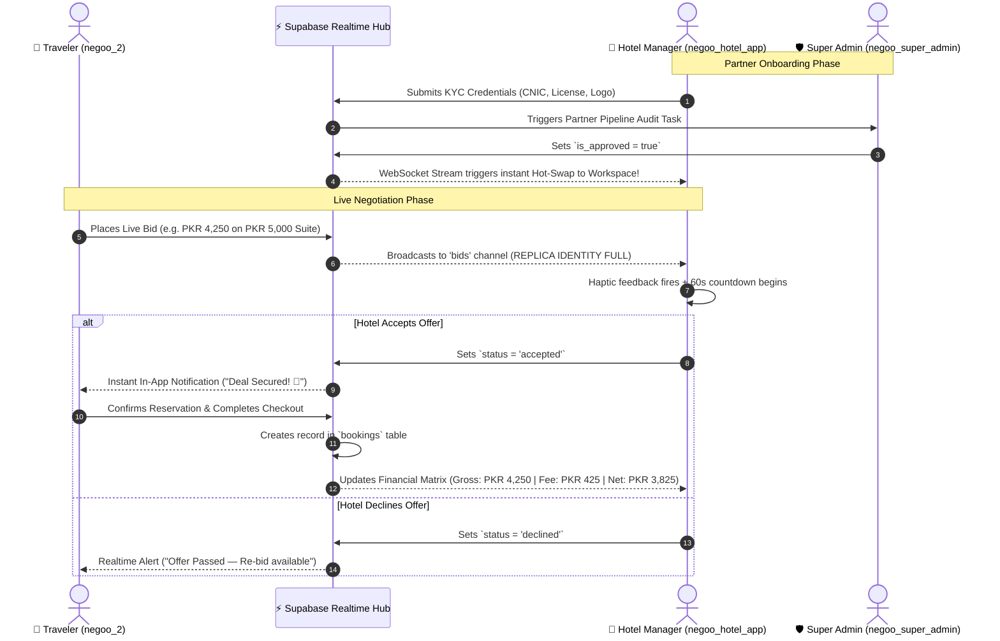
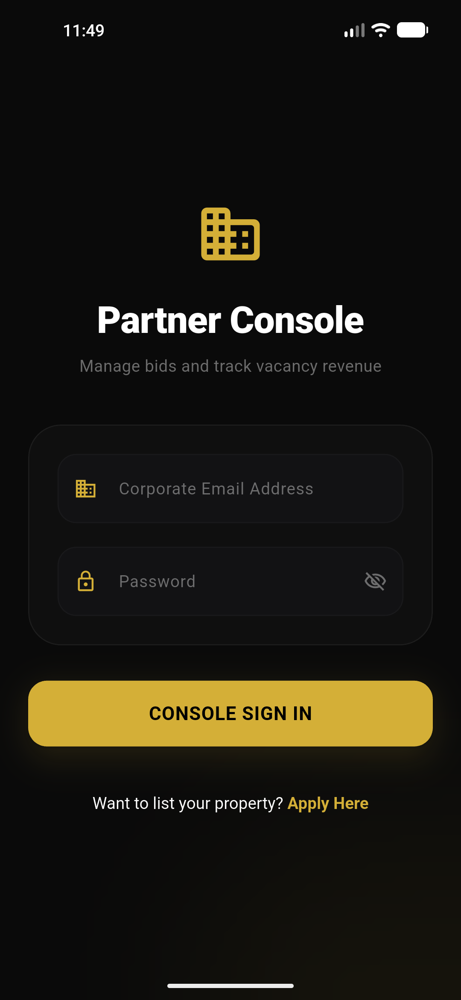
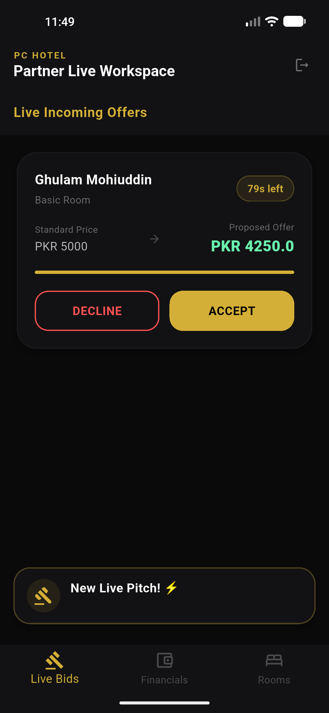
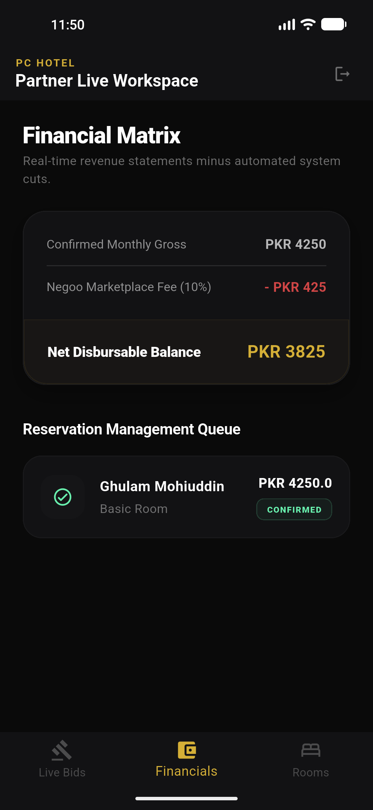
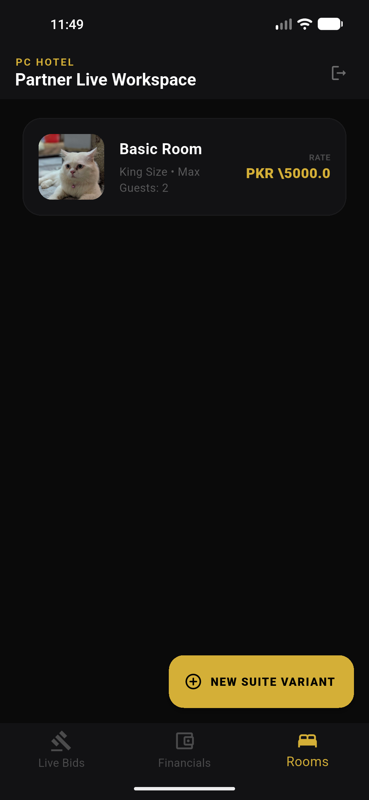
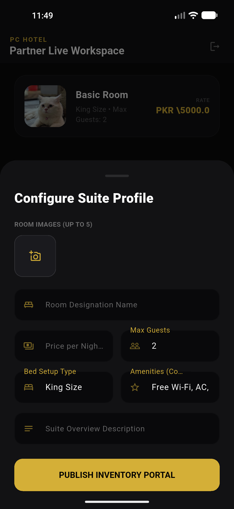

# 🏨 Negoo Partner Console

<div align="center">


<br/>

### **The Real-Time Dynamic Hotel Bidding, Inventory & Financial Settlement Workspace**
*A core pillar of the **Negoo Hospitality Ecosystem** connecting hoteliers directly with travelers through flash price negotiations.*

<br/>

[🌐 Ecosystem Matrix](#-the-negoo-ecosystem-architecture) •
[⚡ Live Bidding Engine](#-live-bidding--flash-negotiation-engine) •
[📸 UI Showcase](#-interactive-ui-showcase) •
[💰 Financial Matrix](#-financial-matrix--automated-ledger) •
[🗄️ Database & Indexing](#-database-architecture--performance-indexing) •
[🚀 Quick Start](#-quick-start--installation)

---

</div>

## 📌 Executive Overview

**Negoo Partner Console (`negoo_hotel_app`)** is a enterprise-grade mobile and desktop management workstation tailored specifically for hotel owners, general managers, and front-desk operators. 

Built with a bespoke **Gold & Obsidian Dark Luxury aesthetic** (`#D4AF37` / `#0A0A0A`), it replaces rigid fixed-rate room listings with a **live dynamic negotiation marketplace**. When travelers in the Negoo Guest App discover a room and submit a real-time price offer, hotel managers receive instantaneous WebSocket notifications with sub-second haptic alerts, review the guest's pitch on a synchronized countdown timer, and accept or decline with a single tap.

---

## 🌐 The Negoo Ecosystem Architecture

The **Negoo Ecosystem** is a unified tri-application marketplace designed to eliminate traditional OTA intermediary delays. All three client applications communicate instantaneously through a centralized **Supabase Cloud Realtime Engine**:

```
                              ┌───────────────────────────────────────────┐
                              │           NEGOO ECOSYSTEM HUB             │
                              │       (Supabase Cloud PostgreSQL)         │
                              │  - PostGIS Proximity Geolocation Engine   │
                              │  - Full Row Replica Identity WebSockets   │
                              │  - Row Level Security (RLS) & Storage     │
                              └─────────────────────┬─────────────────────┘
                                                    │
            ┌───────────────────────────────────────┼──────────────────────────────────────┐
            │ Real-Time Bids & Bookings             │ Real-Time State Sync                 │ Partner KYC Verification
            ▼                                       ▼                                      ▼
┌────────────────────────┐              ┌────────────────────────┐             ┌────────────────────────┐
│    📱 NEGOO GUEST      │              │    🏨 NEGOO PARTNER    │             │   🛡️ NEGOO SUPER       │
│      APP (negoo_2)     │ ◄──────────► │    CONSOLE (THIS REPO) │ ◄─────────► │    ADMIN PORTAL        │
├────────────────────────┤              ├────────────────────────┤             ├────────────────────────┤
│ • Proximity Explorer   │  Dynamic Bid │ • Real-Time Offers Hub │  Partner    │ • KYC Audit Pipeline   │
│ • Real-time Bidding    │  Negotiation │ • 60s Decision Ticker  │  Compliance │ • Approval Hot-Swap    │
│ • Instant Deal Booking │  Stream      │ • Inventory & Suites   │  & Auditing │ • Macro GMV Analytics  │
│ • Traveler Profile     │              │ • Financial Matrix     │             │ • Platform Governance  │
└────────────────────────┘              └────────────────────────┘             └────────────────────────┘
```

### 🧩 Ecosystem Component Breakdown

| System Layer | Repository / Target | Primary Functionality | Target Users |
| :--- | :--- | :--- | :--- |
| **🏨 Partner Console** *(This Repo)* | `negoo_hotel_app` | Real-time bid intake, room catalog management, automated 10% platform fee calculation, disbursable balance ledger. | Hotel Owners, Front Desk Staff, Property Managers |
| **📱 Guest Experience App** | `negoo_2` | Proximity radius discovery (`get_nearby_hotels`), live bidding negotiation, room reservation checkout, favorites. | Travelers, Guests, Business Commuters |
| **🛡️ Governance Hub** | `negoo_super_admin` | KYC verification pipeline, instant `is_approved` hot-swap toggle, macro transaction metrics, platform commission settlement. | Platform Super Admins & Compliance Officers |
| **⚡ Real-Time Engine** | Supabase Cloud | PostgreSQL database, PostGIS spatial queries, WebSocket publications (`supabase_realtime`), secure asset buckets. | Shared Infrastructure |

---

## 🔄 Live Bidding & Ecosystem Sequence Diagram

This sequence illustrates how a dynamic bid travels across the **Negoo Ecosystem** in under two seconds:



---

## 📸 Interactive UI Showcase

The **Negoo Partner Console** delivers an ultra-high contrast dark theme built specifically for high-stress operational environments.

| Screen 1: Partner Authentication | Screen 2: Live Incoming Offers | Screen 3: Financial Matrix Ledger |
| :---: | :---: | :---: |
|  |  |  |
| **Enterprise Sign-In**<br/>Secure session persistence with corporate credentials and KYC onboard routing. | **Live Incoming Bids**<br/>Real-time offers feed with countdown timer, counter-price comparisons, and single-tap actions. | **Financial Ledger**<br/>Automated gross booking calculations, 10% platform fee deduction, and net payout tracking. |

<br/>

| Screen 4: Room Inventory Workspace | Screen 5: Suite Profile Configurator |
| :---: | :---: |
|  |  |
| **Inventory Matrix**<br/>Instant overview of active suite variants, standard base rates, and occupancy limits. | **Suite Profile Bottom Sheet**<br/>Multi-photo asset upload (up to 5), bed configuration, amenities tagging, and live publishing. |

---

## ⚡ Core Feature Matrix & Deep Dives

<details open>
<summary><b>🎯 1. Live Bidding & Flash Negotiation Engine (Click to expand)</b></summary>
<br/>

- **Sub-Second WebSocket Feed**: Streams pending bids filtered directly by `hotel_id` from Supabase:
  ```dart
  Supabase.instance.client
      .from('bids')
      .stream(primaryKey: ['id'])
      .eq('hotel_id', currentHotelId)
  ```
- **Synchronized Countdown Ticker**: Compares server timestamp `expires_at` against device clock to enforce time-bounded decision windows (default: 60 to 90 seconds).
- **Physical Haptic Alerting**: Fires `HapticFeedback.vibrate()` immediately upon incoming bid arrival so front-desk managers never miss an offer.
- **One-Tap Accept / Decline**: Mutates row state in milliseconds, triggering bidirectional notification dispatches back to the traveler.
</details>

<details>
<summary><b>💰 2. Financial Matrix & Automated Platform Ledger (Click to expand)</b></summary>
<br/>

- **Precise PostgreSQL Inner Join Queries**:
  ```dart
  _supabase
      .from('bookings')
      .select('*, rooms!fk_room(room_type, hotel_id)')
      .eq('rooms.hotel_id', userId)
      .order('created_at', ascending: false)
  ```
- **Automated Marketplace Commission Model**:
  - `Confirmed Monthly Gross`: Aggregate sum of all accepted and confirmed stays.
  - `Negoo Marketplace Fee (10%)`: Automatically calculated and segregated in real time.
  - `Net Disbursable Balance`: Clear, auditable profit ready for partner withdrawal.
- **Reservation Management Queue**: Live audit log of confirmed guests, room designations, and booking IDs with verified check-in states.
</details>

<details>
<summary><b>🛏️ 3. Room Inventory & Suite Variant Manager (Click to expand)</b></summary>
<br/>

- **Multi-Photo Cloud Ingestion**: Integrates `image_picker` to upload up to 5 high-resolution room photos directly into Supabase Storage bucket (`hotel_assets`).
- **Granular Room Specifications**:
  - Room Designation Name (e.g. *Deluxe Executive Suite*, *Royal Presidential*)
  - Nightly Base Rate (PKR)
  - Maximum Guest Occupancy
  - Bed Setup Configurations (*King Size, Queen, Executive Twin*)
  - Amenities Checklist (*High-Speed Wi-Fi, Climate Control, Smart TV, Continental Breakfast*)
- **Zero-Downtime Catalog Updates**: Adding a room instantly propagates to the **Negoo Guest App** map and catalog.
</details>

<details>
<summary><b>🔐 4. KYC Compliance & Admin Approval Hot-Swap (Click to expand)</b></summary>
<br/>

- **Partner Onboarding Multi-Step Wizard**:
  - Government CNIC card upload & National ID number validation
  - Official Hotel Commercial Registration / Trade License upload
  - Property facade & logo asset verification
- **Zero-Refresh Approval Hot-Swap**: While waiting for Super Admin approval, the app stays on `HotelPendingScreen` listening live to the hotel table. The moment the Super Admin approves the partner in `negoo_super_admin`:
  ```dart
  if (isApproved) {
    Navigator.pushReplacementNamed(context, '/hotel_main_dashboard');
  }
  ```
  The screen automatically transitions into the full live workspace without requiring the user to restart or re-login!
</details>

<details>
<summary><b>🔔 5. Pure Supabase Realtime Notification Hub (Click to expand)</b></summary>
<br/>

- **Zero Third-Party Bloat (FCM-Free)**: Operates directly through Supabase Realtime channels and an in-app `notifications` table.
- **Row-Level Security (RLS)**: Enforces strict data isolation so hotel partners only see notifications destined for their specific `hotel_id`.
- **Bid Event Dispatcher**: Emits instant event payloads when deals are finalized or renegotiated.
</details>

---

## 🗄️ Database Architecture & Performance Indexing

The application is backed by the comprehensive database script [`supabase_schema_and_indexes.sql`](supabase_schema_and_indexes.sql), engineered for sub-millisecond query execution:

### ⚡ Key Database Optimizations
- **Full Row Replica Identity**:
  ```sql
  ALTER TABLE public.bids REPLICA IDENTITY FULL;
  ALTER TABLE public.bookings REPLICA IDENTITY FULL;
  ALTER TABLE public.notifications REPLICA IDENTITY FULL;
  ```
  Ensures real-time WebSocket consumers receive the full previous and new state during row mutations.
- **Compound Performance Indexes**:
  - `idx_bids_hotel_status (hotel_id, status)`: Speeds up live incoming offers feed to `< 2ms`.
  - `idx_bookings_room_id (room_id)`: Accelerates financial matrix inner joins.
  - `idx_bids_expires_at`: Fast expiration sweeps for pending deals.
- **PostGIS Spatial Extension**: Enables `get_nearby_hotels()` RPC function powering proximity radius search for the guest client.

---

## 🚀 Quick Start & Installation

### 📋 Prerequisites
- [Flutter SDK](https://docs.flutter.dev/get-started/install) (`^3.11.0` or higher)
- [Dart SDK](https://dart.dev/get-dart)
- [Android Studio](https://developer.android.com/studio) / [Xcode](https://developer.apple.com/xcode/) / Chrome (for Web)
- A [Supabase](https://supabase.com/) project with the database schema applied

### 🛠️ Step-by-Step Setup

1. **Clone the Repository**:
   ```bash
   git clone https://github.com/Ghulam-Mohiuddin007/negoo_hotel_app.git
   cd negoo_hotel_app
   ```

2. **Install Flutter Dependencies**:
   ```bash
   flutter pub get
   ```

3. **Verify Database Configuration**:
   The application connects to the unified Negoo Supabase project defined in [`lib/main.dart`](lib/main.dart):
   ```dart
   await Supabase.initialize(
     url: 'YOUR_SUPABASE_PROJECT_URL',
     anonKey: 'YOUR_SUPABASE_ANON_KEY',
   );
   ```
   > 💡 *To execute database migrations and apply indexing, run [`supabase_schema_and_indexes.sql`](supabase_schema_and_indexes.sql) inside your Supabase SQL Editor.*

4. **Run the Application**:
   ```bash
   # Run on connected Android / iOS device
   flutter run

   # Or run on Chrome for Web Console testing
   flutter run -d chrome
   ```

---

## 📁 Project Directory Structure

```text
negoo_hotel_app/
├── lib/
│   ├── main.dart                      # App entry point, Supabase initialization & session gating
│   ├── login.dart                     # Corporate partner sign-in & KYC pipeline routing
│   ├── singup.dart                    # Property registration & account onboarding
│   ├── verification.dart              # KYC document ingestion (CNIC, Trade License, Logo)
│   ├── pending.dart                   # Real-time WebSocket approval listener & radar UI
│   ├── dashboard.dart                 # Navigation shell for partner workspaces
│   ├── live_bids_tab.dart             # Real-time incoming offers stream & countdown ticker
│   ├── financials_tab.dart            # Financial matrix, 10% fee ledger & reservation queue
│   ├── rooms_tab.dart                 # Inventory matrix & suite configuration bottom sheet
│   ├── splash.dart                    # Luxury gold branded splash screen
│   └── services/
│       └── notification_service.dart  # Pure Supabase Realtime notification dispatch hub
├── screenshots/                       # High-resolution production UI captures
│   ├── Screenshot_1791571750.png      # Partner Console Login Screen
│   ├── Screenshot_1791571779.png      # Rooms Inventory Management
│   ├── Screenshot_1791571781.png      # Configure Suite Profile Modal
│   ├── Screenshot_1791571791.png      # Live Bids Negotiation Workspace
│   └── Screenshot_1791571826.png      # Financial Matrix & Reservation Queue
├── supabase_schema_and_indexes.sql    # Complete PostgreSQL schema, RLS policies & indexes
└── pubspec.yaml                       # Flutter dependencies & platform assets
```

---

## 🔗 The Negoo Repository Network

| Repository | Role in Ecosystem | Tech Stack |
| :--- | :--- | :--- |
| [**negoo_hotel_app**](https://github.com/Ghulam-Mohiuddin007/negoo_hotel_app) *(This Repo)* | Hotel Partner Bidding & Inventory Console | Flutter, Supabase Realtime, Dart |
| **negoo_2** | Traveler Discovery, Geolocation Map & Live Bidding App | Flutter, PostGIS, Supabase Auth |
| **negoo_super_admin** | Platform Governance, Partner Vetting & Macro Analytics | Flutter / Web, Supabase RLS |

---

## 👨‍💻 Author & Maintainer

Developed and maintained by **[Ghulam Mohiuddin](https://github.com/Ghulam-Mohiuddin007)**  
*Part of the Negoo Hospitality Platform Engineering Project.*

---

<div align="center">
<sub>Built with 💛 using Flutter & Supabase. Designed for high-speed dynamic hospitality commerce.</sub>
</div>
